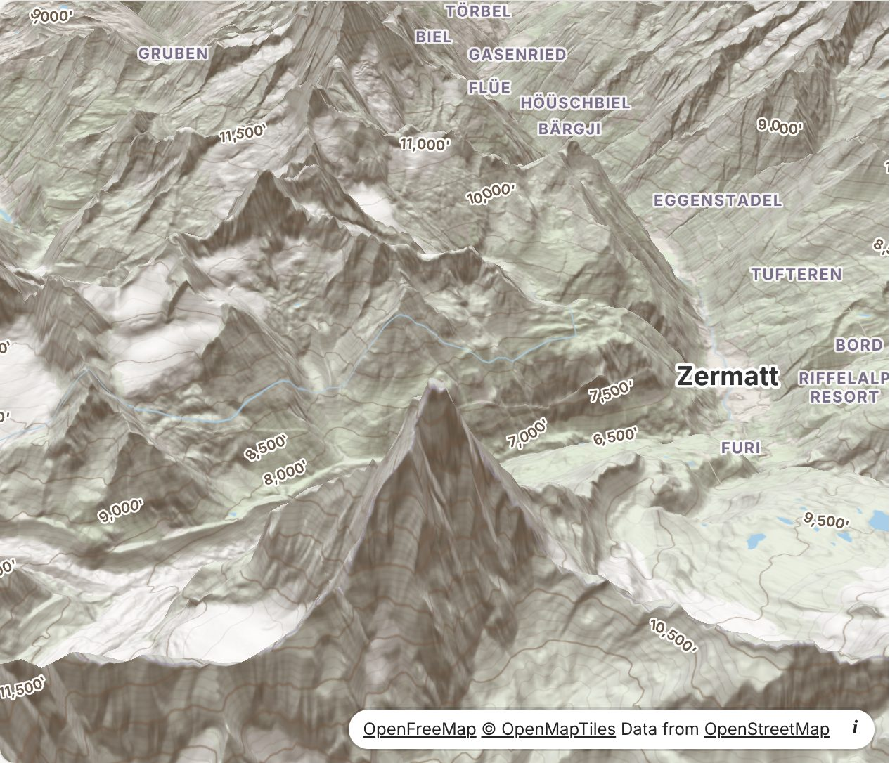
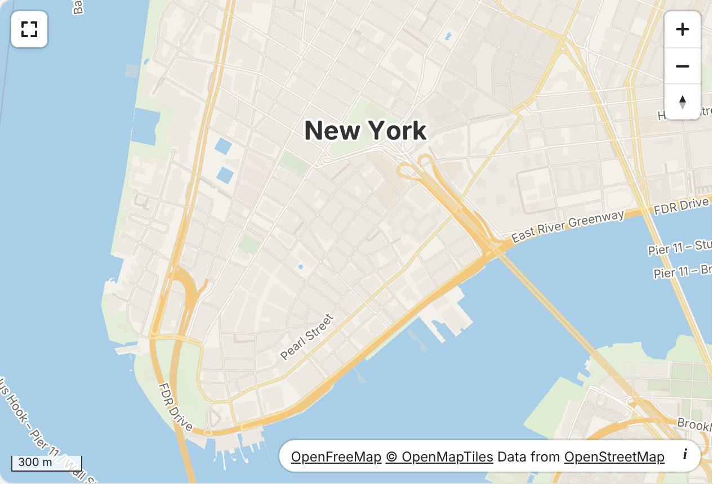
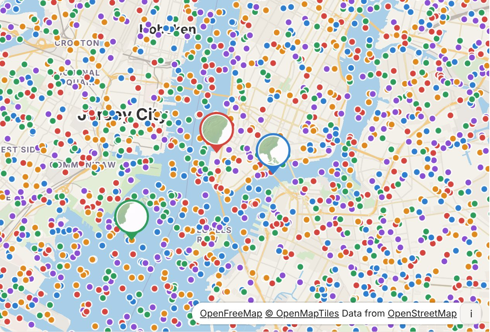
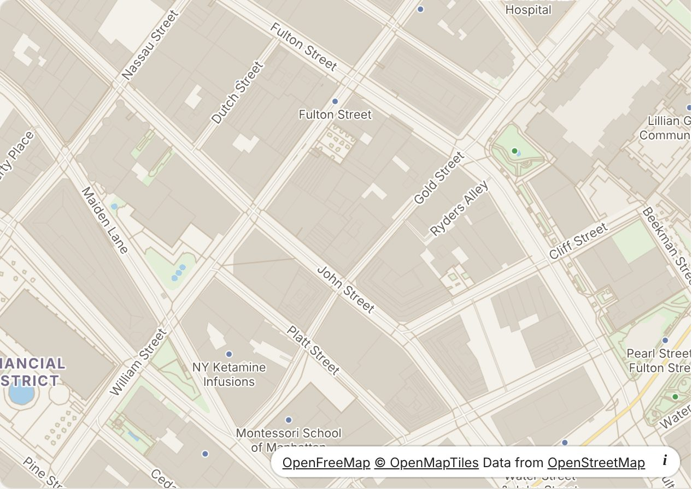
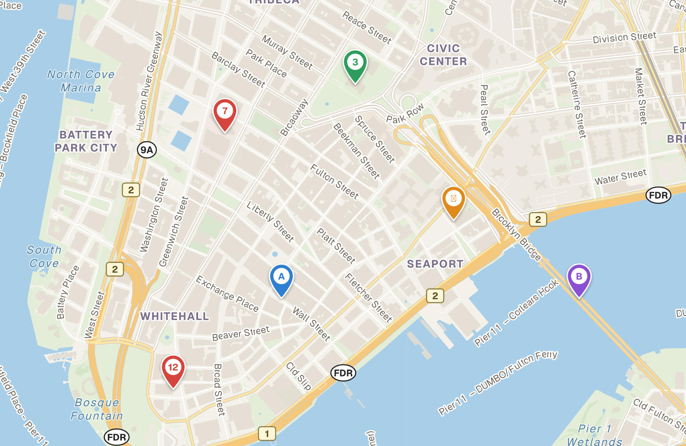
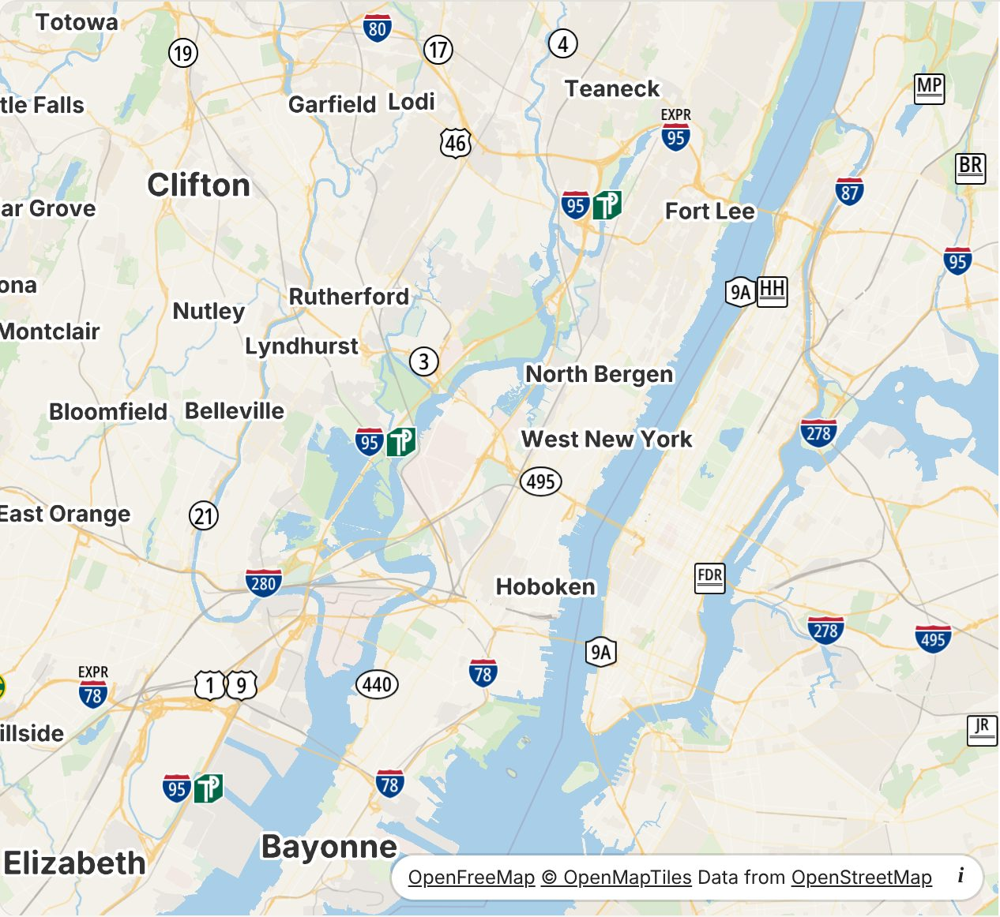

# Map Jr. GL

A small, fast map library for the web. It reads MapLibre styles. It has two entries:

- `map-jr-gl`: a map from one description, with state that your code can watch. The adapters for frameworks
  (`map-jr-gl/vue`, `map-jr-gl/react`) use this entry.
- `map-jr-gl/maplibre-compat`: an API that is almost the same as MapLibre GL JS, for code and plugins that were
  written for that library.



**[Open the live gallery](https://map-jr.github.io/map-jr-gl/)** to see each feature with the code that makes it.

Which entry to use:

| You have | Use | Why |
|---|---|---|
| A new application, or an application with Vue, Nuxt, React or Svelte | `map-jr-gl` and its adapters | New features go to this entry first. |
| Code or plugins that were written for MapLibre GL JS | `map-jr-gl/maplibre-compat` | The code keeps its calls (`new Map`, `map.on`, `map.addLayer`). |

The two entries have different methods. Each example below names its entry. The comparisons with MapLibre GL JS in
[Status](#status) (render tests, example pages, plugins) test `map-jr-gl/maplibre-compat`. The entry `map-jr-gl`
uses the same renderer and has its own tests in a browser.

## Why use this library

- **It is small.** A page with a map transfers about 88 KB of script (gzip): about 28 KB for the page script of
  `map-jr-gl` and about 60 KB for the worker file. MapLibre GL JS 6.17 transfers about 444 KB (page script, worker
  and CSS). The smaller size does not include a globe and other projections, sky, fog, custom layers and the other
  items in [What is not available](docs/maplibre-compatibility.md#what-is-not-available).
- **It does not block your page.** The map draws in a worker. Your page stays responsive while the map moves.
- **It draws many markers.** A marker layer draws 100,000 SVG markers at 60 frames per second.
- **It draws on the server.** You can render the first view of a map as SVG or as an image, without a browser.
  This works on Node.js and on Cloudflare Workers.
- **It includes elevation tools.** 3D terrain, relief shading, contour lines and elevation queries use one
  elevation source. You do not need a plugin.
- **It answers questions about the data.** `queryFeatures` with `sources` reads the tile data directly. You do not
  need a style layer.
- **Fonts as the style gives them, or none to download.** Text uses the glyph files of the style, as MapLibre GL JS does. With `glyphs: false`, text uses the fonts of the browser: no requests for fonts.
- **It is easy to change to.** Most MapLibre GL JS code works after you change the import to
  `map-jr-gl/maplibre-compat`.
- **It works with MapLibre plugins.** mapbox-gl-draw, terra-draw, the compare and sync-move plugins and others run
  without changes. See [Plugins and frameworks](docs/ecosystem.md).

## Status

<!-- status:start -->
These figures are written by `pnpm status`. They compare this library with MapLibre GL JS 6.17.0.

| Measure | Result |
|---|---|
| Unit tests | 37 pass, 0 fail |
| MapLibre expression tests | 330 of 425 pass |
| MapLibre `Map` methods | 118 of 150 are available; 12 more are accepted and have no effect |
| MapLibre plugins, run in a browser | 15 of 15 work (see [Plugins and frameworks](docs/ecosystem.md)) |
| Plugins and frameworks, read from npm | 17 of 26 use only API that the library has |
| Example pages of the MapLibre documentation, with this library in place of MapLibre | 110 of 142 work. Most of the others need a globe, another projection or a custom 3D layer. |
| MapLibre render tests | 819 of 1429 are the same (1% of pixels or less are different). 280 more are near (5% or less). |
| Page script (gzip) | 29 KB. MapLibre GL JS: 299 KB. |
| Worker script (gzip) | 60 KB. MapLibre GL JS: 145 KB. |
| Server renderer (gzip) | 36 KB |
<!-- status:end -->

The library is new. Read [MapLibre compatibility](docs/maplibre-compatibility.md) before you use it in production.

## Install

The package is not on npm yet. Build it from this repository:

```bash
git clone https://github.com/map-jr/map-jr-gl.git
```

```bash
cd map-jr-gl
```

```bash
pnpm install
```

```bash
pnpm build
```

The build writes the library to the `dist` folder. Then use one of these methods:

- **With a bundler (Vite, webpack, Rollup, Parcel):** add the folder to your project as a dependency
  (`pnpm add ../map-jr-gl`). Then import from `map-jr-gl`.
- **Without a bundler:** copy the `dist` folder to your web server. Then import `dist/map-jr-gl.js` in a module
  script (or `dist/map-jr-gl-maplibre-compat.js` for the API of MapLibre GL JS).

The package contains ES modules only (`"type": "module"`). It has no CommonJS build, so `require('map-jr-gl')` does
not work: use `import`. The tests of the server renderer (`map-jr-gl/server`) run with Node.js 22, and `engines` in
`package.json` asks for Node.js 22 or later. The module for Nuxt (`map-jr-gl/nuxt`) imports `@nuxt/kit`, which a Nuxt
application has already. `package.json` names it as an optional peer dependency (version 3 or 4).

Each built file has a source map beside it (`dist/<file>.js.map`), so that an error tracker can show the lines of the
source for a stack trace.

## Use

### Show a map

This example uses the entry `map-jr-gl`.

```html
<div id="map" style="height: 400px"></div>
<script type="module">
  import {createMap} from 'map-jr-gl';

  const map = createMap(document.getElementById('map'), {
    style: 'https://tiles.openfreemap.org/styles/liberty',
    initialView: {center: [-74.0065, 40.7085], zoom: 13.6},
  });

  // The state of the map is a store. This function runs when the view changes.
  map.state.subscribe(state => state.view, view => console.log(view.zoom));
</script>
```

To change the map, call `map.update` with the complete description again. The library finds what is different.
You do not need a CSS file. See [The main API](docs/api.md).



### Use Vue or Nuxt

```vue
<script setup>
import {ref} from 'vue';
import {MapJr} from 'map-jr-gl/vue';

const view = ref({center: [-74.0065, 40.7085], zoom: 13.6});
</script>

<template>
  <div style="height: 400px">
    <MapJr map-style="https://tiles.openfreemap.org/styles/liberty" v-model:view="view" ssr />
  </div>
</template>
```

With the `ssr` prop, a server (Nuxt) renders the first view as SVG into the page. The map takes over in the
browser. See [Vue and Nuxt](docs/vue.md).

### Change from MapLibre GL JS

The entry `map-jr-gl/maplibre-compat` has the API of MapLibre GL JS: `new Map({...})`, `map.on(...)`,
`map.addLayer(...)`, controls, `Marker` and `Popup`.

1. Change the name of the module in each import:

   ```js
   // import {Map, Marker, Popup} from 'maplibre-gl';
   import {Map, Marker, Popup} from 'map-jr-gl/maplibre-compat';
   ```

   If your code uses one object for the library (`maplibregl.Map`), import all the names into that object:

   ```js
   import * as maplibregl from 'map-jr-gl/maplibre-compat';
   ```

2. Remove the import of `maplibre-gl.css`.
3. Add `await` where your code calls `queryRenderedFeatures` or `querySourceFeatures`. The tile data is in a worker,
   so the complete result is a promise.
4. Start your application and read the browser console. The library writes a warning for each style layer or
   property that it cannot draw.
5. Read [MapLibre compatibility](docs/maplibre-compatibility.md) for the differences.

A plugin that was written for MapLibre GL JS imports `maplibre-gl` itself. Map that name to this library in your
bundler (`resolve.alias` in Vite, `alias` in esbuild) or in an import map:

```html
<script type="importmap">{"imports": {"maplibre-gl": "/node_modules/map-jr-gl/dist/map-jr-gl-maplibre-compat.js"}}</script>
```

The library has a default export for such plugins only, because some of them contain
`import maplibregl from 'maplibre-gl'`. [Ecosystem](docs/ecosystem.md) lists the plugins that are tested.

### Add markers

A marker layer draws many markers on the map canvas. Each marker is an SVG template with values from your data.

With `map-jr-gl`, a marker layer is an entry of `markers` in the description:

```js
import {createMap} from 'map-jr-gl';

const places = {
  id: 'places',
  svg: '<svg viewBox="0 0 24 24"><circle cx="12" cy="12" r="10" fill="{{color}}"/></svg>',
  width: 24,
  height: 24,
  data: [
    {lngLat: [-74.006, 40.7128], props: {color: '#d6453d', name: 'City Hall'}},
    {lngLat: [-73.9857, 40.7484], props: {color: '#2f7fd1', name: 'Empire State Building'}},
  ],
};

const map = createMap(document.getElementById('map'), {
  style: 'https://tiles.openfreemap.org/styles/liberty',
  initialView: {center: [-73.996, 40.73], zoom: 11.5},
  markers: [places],
});

map.listen('markerclick', event => {
  event.layer.openPopup(event.index, event.marker.props.name);
});
```

With `map-jr-gl/maplibre-compat`, `map` is a `Map`, and the same layer and listener are method calls:

```js
map.addMarkerLayer(places);

map.on('markerclick', event => {
  event.layer.openPopup(event.index, event.marker.props.name);
});
```

For a small number of markers with HTML content, use `map.overlay` (`map-jr-gl`) or `Marker` and `Popup`
(`map-jr-gl/maplibre-compat`, the same API as MapLibre GL JS). See [Markers](docs/markers.md).



### Show terrain, relief and contour lines

With `map-jr-gl`, the elevation source, the layers and the terrain are additions to the style (`extend`):

```js
import {createMap} from 'map-jr-gl';

const map = createMap(document.getElementById('map'), {
  style: 'https://tiles.openfreemap.org/styles/liberty',
  initialView: {center: [7.6586, 45.9763], zoom: 12.4, pitch: 60},
  extend: {
    sources: {
      dem: {type: 'raster-dem', tiles: ['https://tiles.mapterhorn.com/{z}/{x}/{y}.webp'], encoding: 'terrarium', tileSize: 512, maxzoom: 12},
      contours: {type: 'contour', source: 'dem', thresholds: {11: [100, 500], 12: [50, 200], 14: [20, 100]}},
    },
    layers: [
      {id: 'relief', type: 'hillshade', source: 'dem'},
      {id: 'contour-lines', type: 'line', source: 'contours', 'source-layer': 'contours'},
    ],
    terrain: {source: 'dem', exaggeration: 1.5},
  },
});

const metres = await map.queryElevation([7.6586, 45.9763]);
```

With `map-jr-gl/maplibre-compat`, where `map` is a `Map` whose style has loaded:

```js
map.addSource('dem', {
  type: 'raster-dem',
  tiles: ['https://tiles.mapterhorn.com/{z}/{x}/{y}.webp'],
  encoding: 'terrarium',
  tileSize: 512,
  maxzoom: 12,
});

map.addLayer({id: 'relief', type: 'hillshade', source: 'dem'});
map.setTerrain({source: 'dem', exaggeration: 1.5});

map.addSource('contours', {
  type: 'contour',
  source: 'dem',
  thresholds: {11: [100, 500], 12: [50, 200], 14: [20, 100]},
});
map.addLayer({id: 'contour-lines', type: 'line', source: 'contours', 'source-layer': 'contours'});

const metres = await map.queryElevation([7.6586, 45.9763]);
```

See [Terrain and elevation](docs/terrain-and-elevation.md).

### Find what is at a position

With `map-jr-gl`, `queryFeatures` with `sources` reads the tile data of those sources. It finds data that the style
does not draw, and it also works for a position that is not on the screen. Without `sources`, it gives the features
that the style layers draw. See [Queries](docs/api.md#queries).

```js
import {createMap} from 'map-jr-gl';

const map = createMap(document.getElementById('map'), {
  style: 'https://tiles.openfreemap.org/styles/liberty',
  initialView: {center: [-74.0065, 40.7085], zoom: 16},
  onClick: async event => {
    // "openmaptiles" is the id of the vector source in this style.
    const features = await map.queryFeatures(event.lngLat, {sources: ['openmaptiles'], radius: 8});
    console.log(features.map(feature => feature.properties));
  },
});
```

With `map-jr-gl/maplibre-compat`, `map.queryFeatures(lngLat, {radius: 8})` always reads the tile data.
`queryRenderedFeatures` and `querySourceFeatures` are also available:

```js
map.on('click', async event => {
  const features = await map.queryFeatures(event.lngLat, {radius: 8});
  console.log(features.map(feature => feature.properties));
});
```



### Render the first view on the server

This example uses the entry `map-jr-gl/server`.

```js
import {renderToSVG} from 'map-jr-gl/server';

const {svg} = await renderToSVG({
  style: 'https://tiles.openfreemap.org/styles/liberty',
  center: [-74.0065, 40.7085],
  zoom: 14.3,
  width: 800,
  height: 500,
});
```

Put the SVG in the map container of your HTML page. The live map replaces it when the map is ready.
See [Server rendering](docs/server-rendering.md).



### Use highway shields and other icons that are generated on demand

This example uses the entry `map-jr-gl/maplibre-compat`, where `map` is a `Map`. The description of `map-jr-gl` has
no field for this yet.

```js
map.setMissingStyleImageResolver(name => {
  if (name.startsWith('shield|')) return map.addImage(name, drawShieldAsSVG(name));
});
```

The OSM Americana shield library works with this library without changes.

A label can contain images (`format` with `image`). So a road with two routes shows two shields side by side.



## How the library loads

The default configuration needs no settings.

- The page loads `map-jr-gl.js`. This file is small.
- The library starts a worker from `map-jr-gl-worker.js`. It finds this file next to `map-jr-gl.js`. Bundlers copy
  the file automatically.
- If a worker cannot start, the library draws on the main thread and writes a warning. A map always appears.

See [Loading](docs/loading.md) for a CDN, a strict Content Security Policy, the one-file
build and other configurations.

## Speed

<!-- speed:start -->
Measured by the workflow [Browsers](https://github.com/map-jr/map-jr-gl/tree/bench-results) on 2026-11-12 (commit 20a7ec0). Each cell is MapLibre GL JS 6.17.0 / **this library** (worker renderer where the browser has it).

| System, browser | Load to idle, ms | Frames per second, map moving | Frames per second, 10,000 markers |
|---|---|---|---|
| macOS, Chromium | 2011 / **747** | 26 / **25** | 3 / **19** |
| macOS, Firefox | 4746 / **8118** | 1 / **11** | 2 / **56** |
| macOS, WebKit | 2438 / **1373** | 58 / **49** | 2 / **57** |
| Linux, Chromium | 865 / **1030** | 12 / **9** | 2 / **10** |
| Linux, Firefox | 1760 / **1272** | 16 / **59** | 5 / **59** |
| Linux, WebKit | 1532 / **1140** | 23 / **23** | 3 / **22** |
| Windows, Chromium | 1214 / **1480** | 42 / **34** | 2 / **30** |
| Windows, Firefox | 1585 / **1940** | 32 / **21** | 4 / **24** |
| Windows, WebKit | 1751 / **1651** | 14 / **14** | 3 / **14** |
<!-- speed:end -->

These computers are virtual machines, and those for Linux and Windows have no GPU: use the table to compare the
two libraries, not as the speed of a real device. On an Apple M4 the two libraries draw 60 frames each second;
this library loads faster (490 ms against 781 ms) and uses no page script for a frame.

To measure on your device, open [the benchmark page](https://map-jr.github.io/map-jr-gl/bench/) of the gallery site, or run `pnpm demo` and open `http://localhost:8080/bench`. `pnpm status` writes the table.

## Documents

- [The main API](docs/api.md): `createMap`, the description of a map, the state, queries.
- [Vue and Nuxt](docs/vue.md): the component, the composable, server rendering.
- [React](docs/react.md): the component, the hooks, server rendering.
- [Svelte](docs/svelte.md): an action and a store.
- [Loading](docs/loading.md): how the files load, and how to change that.
- [Markers](docs/markers.md): marker layers, callouts, and DOM markers.
- [Terrain and elevation](docs/terrain-and-elevation.md): terrain, relief shading, contour lines, elevation queries.
- [Server rendering](docs/server-rendering.md): SVG and images on Node.js and Cloudflare Workers.
- [Accessibility](docs/accessibility.md): what the library does for keyboard users and assistive technology, and what it
  does not do yet.
- [MapLibre compatibility](docs/maplibre-compatibility.md): what is the same, what is different, what is not
  available.
- [Plugins and frameworks](docs/ecosystem.md): which popular MapLibre plugins find the API that they use.
- [Development](docs/development.md): how to build, test and measure the library.
- [Contributing](CONTRIBUTING.md) and the [open issues](https://github.com/map-jr/map-jr-gl/issues): what is known to be wrong or missing, by priority.

## How this project is made

An AI coding assistant wrote almost all the code of this project ("vibe coding"). A person gave the directions and
reviewed the results. Nobody reviewed every line of the code. Read [Acknowledgements](ACKNOWLEDGEMENTS.md) for
more information, and run your own tests before you use the library for important work.

## Licence and acknowledgements

The licence is MIT. See [LICENSE](LICENSE).

The library follows [MapLibre GL JS](https://github.com/maplibre/maplibre-gl-js) (BSD-3-Clause) but contains none of
its files. [Acknowledgements](ACKNOWLEDGEMENTS.md) lists the projects that this library uses or follows.
[THIRD-PARTY-LICENSES.md](THIRD-PARTY-LICENSES.md) contains their licence texts.
