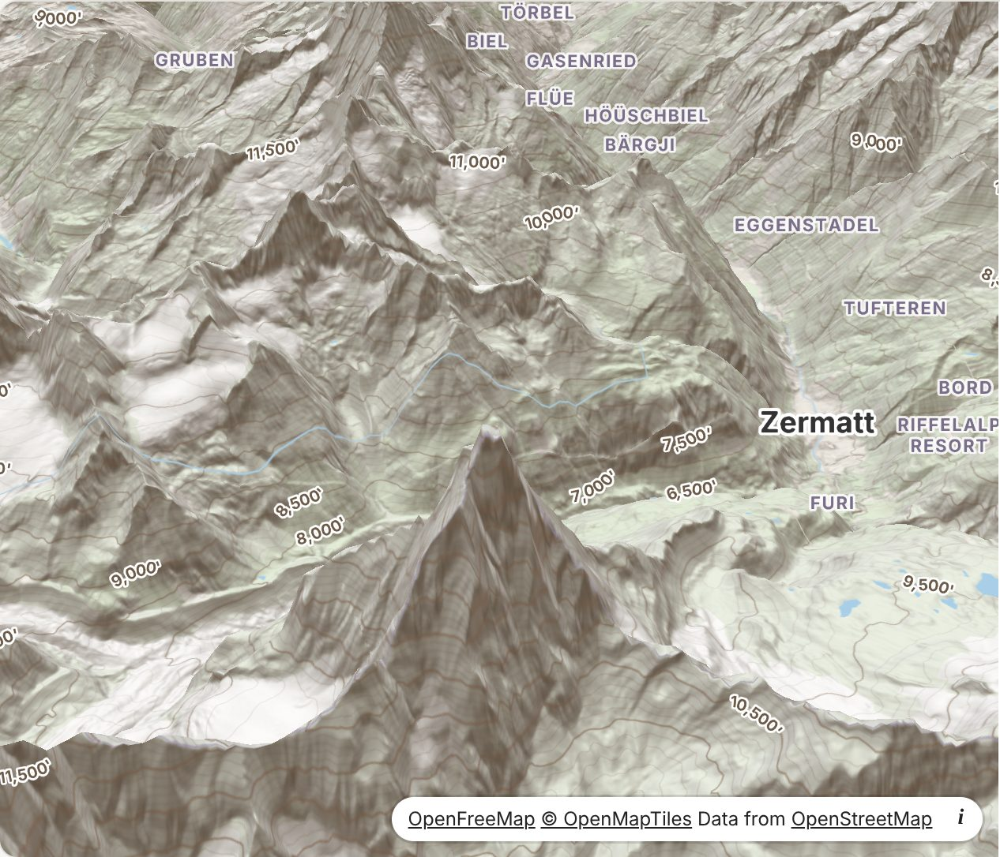

# Map Jr. GL

A small, fast map library for the web. It reads MapLibre styles. Map Jr. GL is a project of Sam Margulies and
whatismyelevation.com. It has two entries:

- `@map-jr/map-jr-gl`: a map from one description, with state that your code can watch. The adapters for frameworks
  (`@map-jr/map-jr-gl/vue`, `@map-jr/map-jr-gl/react`) and the web component `<map-jr>` (`@map-jr/map-jr-gl/element`)
  use this entry.
- `@map-jr/map-jr-gl/maplibre-compat`: an API that is almost the same as MapLibre GL JS, for code and plugins that were
  written for that library.



**[Open the docs site](https://map-jr.org/)** to see each feature with the code that makes it, and try it on [the playground](https://map-jr.org/play).

Which entry to use:

| You have | Use | Why |
|---|---|---|
| A new application, or an application with Vue, Nuxt, React or Svelte | `@map-jr/map-jr-gl` and its adapters | New features go to this entry first. |
| A page in plain HTML, a CMS, or a framework with no adapter (Angular, Lit, Solid) | `@map-jr/map-jr-gl/element` | The element `<map-jr>` takes the description as attributes and properties. |
| Code or plugins that were written for MapLibre GL JS | `@map-jr/map-jr-gl/maplibre-compat` | The code keeps its calls (`new Map`, `map.on`, `map.addLayer`). |

The two entries have different methods. Each example below names its entry. The comparisons with MapLibre GL JS in
[Status](#status) (render tests, example pages, plugins) test `@map-jr/map-jr-gl/maplibre-compat`. The entry `@map-jr/map-jr-gl`
uses the same renderer and has its own tests in a browser.

## Why use this library

- **It is small.** A page with a map transfers the page script and the worker file, which together are about a third
  of what MapLibre GL JS transfers (page script, worker and CSS, gzip). The table of sizes in [Status](#status) has
  the current numbers for each entry. The smaller size does not include other projections than Mercator and the globe, sky, fog and the other items in
  [What is not available](docs/reference/maplibre-differences.md#what-is-not-available). Custom layers are in the entry
  `@map-jr/map-jr-gl/maplibre-compat` and draw on the main thread: a map that draws in a worker moves to the main
  thread at its first custom layer. Their code loads with the first custom layer.
- **It does not block your page.** The map draws in a worker. Your page stays responsive while the map moves.
- **It draws many markers.** A symbol layer with an SVG template as its image draws 100,000 SVG markers at 60 frames
  per second.
- **It draws on the server.** You can render the first view of a map as SVG or as an image, without a browser.
  This works on Node.js and on Cloudflare Workers.
- **It includes elevation tools.** 3D terrain, relief shading, contour lines and elevation queries use one
  elevation source. You do not need a plugin.
- **It answers questions about the data.** `querySource` reads the tile data of a source directly. You do not
  need a style layer.
- **Fonts as the style gives them.** Text uses the glyph files of the style, as MapLibre GL JS does. A style without `glyphs` uses the fonts of the browser and makes no requests for fonts.
- **It is easy to change to.** Most MapLibre GL JS code works after you change the import to
  `@map-jr/map-jr-gl/maplibre-compat`.
- **It works with MapLibre plugins.** mapbox-gl-draw, terra-draw, the compare and sync-move plugins and others run
  without changes. See [Plugins and frameworks](docs/ecosystem.md).

## Status

<!-- status:start -->
These figures are written by `pnpm status`. They compare this library with MapLibre GL JS 6.17.0. The file [docs/status.json](docs/status.json) has the same figures.

Unit tests: 631 pass and 0 fail.

Sizes, in KB (gzip). The page script of MapLibre GL JS includes its CSS. The page script of this library is the file of the entry and the files that it imports when it loads.

| File | Map Jr. GL | MapLibre GL JS | Share |
|---|---:|---:|---:|
| Page script of `@map-jr/map-jr-gl` | 50.6 | 300.1 | 16.9% |
| Page script of `@map-jr/map-jr-gl/maplibre-compat` | 60.4 | 300.1 | 20.1% |
| Worker file | 81.1 | 145.0 | 55.9% |
| Page script and worker file of `@map-jr/map-jr-gl` | 131.7 | 445.1 | 29.6% |
| Page script and worker file of `@map-jr/map-jr-gl/maplibre-compat` | 141.5 | 445.1 | 31.8% |
| Hard line for the page script and the worker file | 148.4 | 445.1 | 33.3% |
| Server renderer | 63.6 |  |  |

Compatibility with MapLibre GL JS, tested with the entry `@map-jr/map-jr-gl/maplibre-compat`:

| Area | Passing | Total | Share | Details |
|---|---:|---:|---:|---|
| MapLibre expression tests | 421 | 583 | 72.2% | [Tests against MapLibre GL JS](docs/development.md#tests-against-maplibre-gl-js) |
| Methods of the MapLibre `Map` class | 134 | 138 | 97.1% | [Map methods](docs/reference/maplibre-differences.md#map-methods) |
| Properties of the MapLibre style specification | 235 | 244 | 96.3% | [Tests against MapLibre GL JS](docs/development.md#tests-against-maplibre-gl-js) |
| MapLibre plugins, run in a browser | 16 | 17 | 94.1% | [Plugins that were run](docs/ecosystem.md#plugins-that-were-run) |
| Plugins and frameworks, read from npm | 26 | 27 | 96.3% | [Each package](docs/ecosystem.md#each-package) |
| Example pages of the MapLibre documentation | 125 | 142 | 88.0% | [Example pages](docs/ecosystem.md#the-example-pages-of-maplibre-gl-js) |
| MapLibre render tests, the same | 1444 | 1758 | 82.1% | [Render tests](docs/development.md#render-tests) |
| MapLibre render tests, the same or near | 1651 | 1758 | 93.9% | [Render tests](docs/development.md#render-tests) |
<!-- status:end -->

The library is new. Read [MapLibre differences](docs/reference/maplibre-differences.md) before you use it in production.

## Install

The package is `@map-jr/map-jr-gl` on npm ([npmjs.com/package/@map-jr/map-jr-gl](https://www.npmjs.com/package/@map-jr/map-jr-gl)).
Install it with your package manager:

```bash
npm install @map-jr/map-jr-gl
```

Then import from `@map-jr/map-jr-gl`, or from `@map-jr/map-jr-gl/maplibre-compat` for the API of MapLibre GL JS.

To use a build of the current source instead of the release on npm, build the package from this repository:

```bash
git clone https://github.com/map-jr/map-jr-gl.git
```

```bash
cd map-jr-gl
```

```bash
pnpm install
```

```bash
pnpm build
```

The build writes the library to the `dist` folder. Then use one of these methods:

- **With a bundler (Vite, webpack, Rollup, Parcel):** add the folder to your project as a dependency
  (`pnpm add ../map-jr-gl`). Then import from `@map-jr/map-jr-gl`.
- **Without a bundler:** copy the `dist` folder to your web server. Then import `dist/map-jr-gl.js` in a module
  script (or `dist/map-jr-gl-maplibre-compat.js` for the API of MapLibre GL JS).

The package contains ES modules only (`"type": "module"`). It has no CommonJS build, so `require('@map-jr/map-jr-gl')` does
not work: use `import`. The tests of the server renderer (`@map-jr/map-jr-gl/server`) run with Node.js 22, and `engines` in
`package.json` asks for Node.js 22 or later. The module for Nuxt (`@map-jr/map-jr-gl/nuxt`) imports `@nuxt/kit`, which a Nuxt
application has already. `package.json` names it as an optional peer dependency (version 3 or 4).

A browser must have WebGL2. [Browser support](docs/guide/browser-support.md) says what each renderer needs and in which
browsers the library was run.

Each built file has a source map beside it (`dist/<file>.js.map`), so that an error tracker can show the lines of the
source for a stack trace.

## Use

### Show a map

This example uses the entry `@map-jr/map-jr-gl`.

```html
<div id="map" style="height: 400px"></div>
<script type="module">
  import {createMap} from '@map-jr/map-jr-gl';

  const map = createMap(document.getElementById('map'), {
    style: 'https://styles.map-jr.org/1/elevation-zero.json',
    initialView: {center: [-74.0065, 40.7085], zoom: 13.6},
  });

  // The state of the map is a store. This function runs when the view changes.
  map.state.subscribe(state => state.view, view => console.log(view.zoom));
</script>
```

To change the map, call `map.update` with the complete description again. The library finds what is different.
You do not need a CSS file. See [The main API](docs/reference/create-map.md).


### Other tasks

Each task has a page of the guide or a recipe, with the code of each entry and adapter:

- [Vue and Nuxt](docs/reference/vue.md), [React](docs/reference/react.md), [Svelte](docs/reference/svelte.md) and
  [the element `<map-jr>`](docs/reference/element.md).
- [From MapLibre GL JS](docs/migrate/from-maplibre.md): change the imports to `@map-jr/map-jr-gl/maplibre-compat`.
  [Wrappers and plugins](docs/migrate/wrappers.md) covers react-map-gl and the alias of `maplibre-gl`, and the
  [migration prompt](docs/migrate/prompt.md) lets a coding agent do the steps.
- [Markers and popups](docs/guide/markers-and-popups.md).
- [Terrain and elevation](docs/guide/terrain.md): terrain, hillshade, contour lines and elevation queries.
- [Query what is at a position](docs/recipes/query.md).
- [Server rendering](docs/guide/server-rendering.md): the first view as SVG, on a server or in the browser.
- [Images and fonts](docs/guide/images-and-fonts.md): images of the style layers, highway shields that the page creates when a layer asks for them, and web fonts.
- [Loading](docs/guide/loading.md): the worker file, a CDN, a strict Content Security Policy and the one-file build.

## Speed

<!-- speed:start -->
Measured by the workflow [Browsers](https://github.com/map-jr/map-jr-gl/tree/bench-results) on 2026-11-28 (commit 8f77158), next to MapLibre GL JS 6.17.0. Map Jr. GL uses the worker renderer where the browser has it. The ratio is the number of Map Jr. GL divided by the number of MapLibre GL JS.

Load to idle, in milliseconds. A ratio below 1 means that Map Jr. GL is faster.

| System, browser | MapLibre GL JS | Map Jr. GL | Ratio |
|---|---:|---:|---:|
| macOS, Chromium | 832 | 379 | 0.46 |
| Linux, Chromium | 519 | 432 | 0.83 |
| Linux, Firefox | 1342 | 594 | 0.44 |
| Linux, WebKit | 2602 | 978 | 0.38 |

Frames per second while the map moves. A ratio above 1 means that Map Jr. GL is faster.

| System, browser | MapLibre GL JS | Map Jr. GL | Ratio |
|---|---:|---:|---:|
| macOS, Chromium | 21 | 26 | 1.19 |
| Linux, Chromium | 12 | 9 | 0.81 |
| Linux, Firefox | 18 | 56 | 3.11 |
| Linux, WebKit | 11 | 11 | 0.99 |

Frames per second while a map with 10,000 markers moves. A ratio above 1 means that Map Jr. GL is faster.

| System, browser | MapLibre GL JS | Map Jr. GL | Ratio |
|---|---:|---:|---:|
| macOS, Chromium | 7 | 19 | 2.85 |
| Linux, Chromium | 4 | 14 | 3.90 |
| Linux, Firefox | 6 | 44 | 7.20 |
| Linux, WebKit | 2 | 13 | 7.26 |
<!-- speed:end -->

These computers are virtual machines, and those for Linux and Windows have no GPU: use the tables to compare the
two libraries, not as the speed of a real device. On an Apple M4 the two libraries draw 60 frames each second;
this library loads faster (490 ms against 781 ms) and uses no page script for a frame.

To measure on your device, open [the benchmark page](https://map-jr.org/bench/) of the docs site, or run `pnpm demo` and open `http://localhost:8080/bench`. `pnpm status` writes the tables.

## Documents

The documentation is on [map-jr.org](https://map-jr.org/) and in four folders of `docs/`, which the package contains:

- [Guide](docs/guide/getting-started.md): how to do each task, from a first map to
  [markers and popups](docs/guide/markers-and-popups.md), [terrain](docs/guide/terrain.md),
  [server rendering](docs/guide/server-rendering.md), [loading](docs/guide/loading.md),
  [browser support](docs/guide/browser-support.md) and [accessibility](docs/guide/accessibility.md).
- [Recipes](docs/recipes/reactive.md): complete examples in each of their seven forms.
- [Reference](docs/reference/create-map.md): every function, field, event and type of each entry:
  [the description](docs/reference/description.md), [the map](docs/reference/map.md),
  [Vue](docs/reference/vue.md), [Nuxt](docs/reference/nuxt.md), [React](docs/reference/react.md),
  [Svelte](docs/reference/svelte.md), [the element `<map-jr>`](docs/reference/element.md),
  [the compat entry](docs/reference/maplibre-compat.md) and its
  [differences from MapLibre GL JS](docs/reference/maplibre-differences.md).
- [Migrate](docs/migrate/from-maplibre.md): the steps from MapLibre GL JS, from a wrapper, and from the compat entry to
  the main API.

These files are in the repository and not in the package:

- [Plugins and frameworks](docs/ecosystem.md): which popular MapLibre plugins find the API that they use.
- [Development](docs/development.md): how to build, test, measure and release the library.
- [Similarity scan](docs/development/similarity-scan.md): how the source was compared with MapLibre GL JS and other projects, and
  the result.
- [Changelog](CHANGELOG.md): what each version contains, and what is known not to work. The package contains it.
- [Security](SECURITY.md): how to report a vulnerability privately, and what is in scope.
- [Contributing](CONTRIBUTING.md) and the [open issues](https://github.com/map-jr/map-jr-gl/issues): what is known to be wrong or missing, by priority.

## How this project is made

Map Jr. GL is a project of Sam Margulies and whatismyelevation.com. An AI coding assistant wrote almost all the code
of this project ("vibe coding"). A person gave the directions and reviewed the results. Nobody reviewed every line of the code. Read [Acknowledgements](ACKNOWLEDGEMENTS.md) for
more information, and run your own tests before you use the library for important work.

## License and acknowledgements

The license is MIT. See [LICENSE](LICENSE).

The library follows [MapLibre GL JS](https://github.com/maplibre/maplibre-gl-js) (BSD-3-Clause) but contains none of
its files. A [similarity scan](docs/development/similarity-scan.md) of the source against MapLibre GL JS 6.17.0 and the other
projects found no copied block. [Acknowledgements](ACKNOWLEDGEMENTS.md) lists the projects that this library uses or follows.
[THIRD-PARTY-LICENSES.md](THIRD-PARTY-LICENSES.md) contains their license texts.
