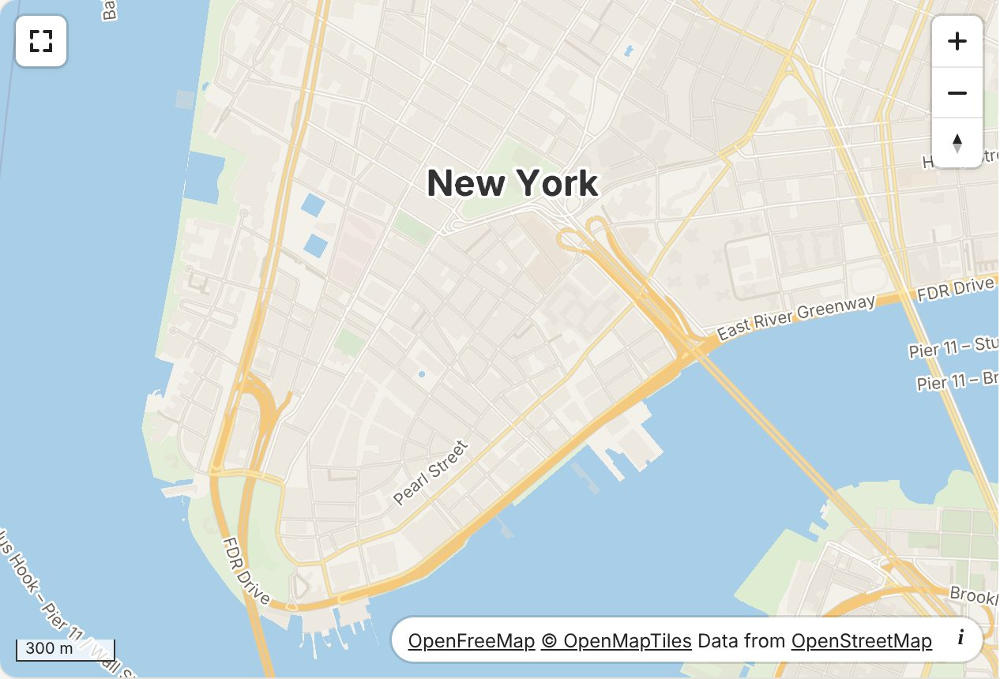
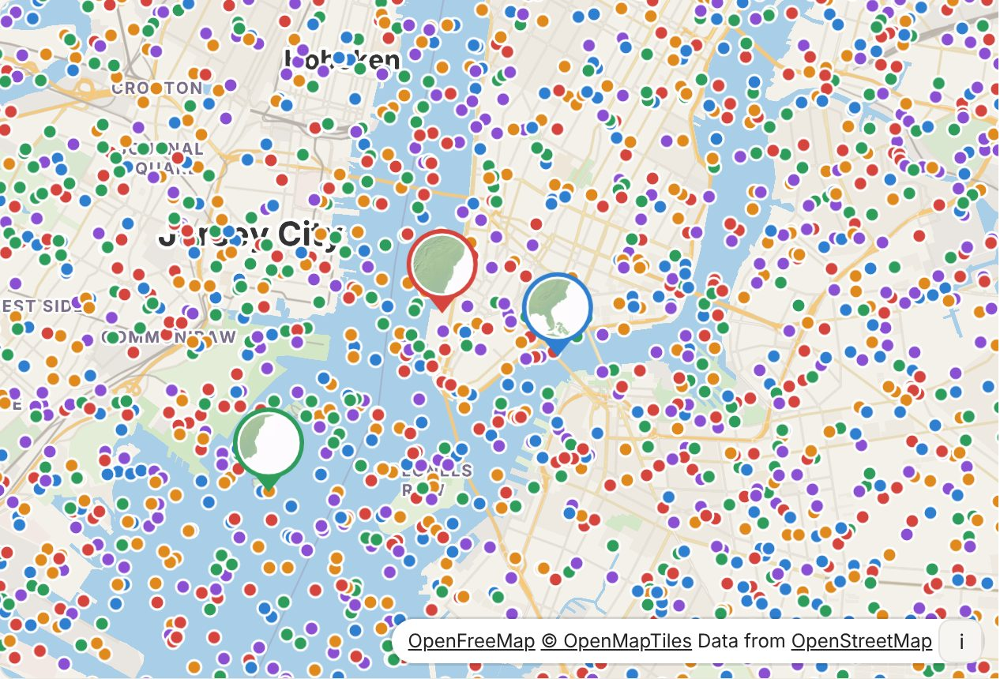
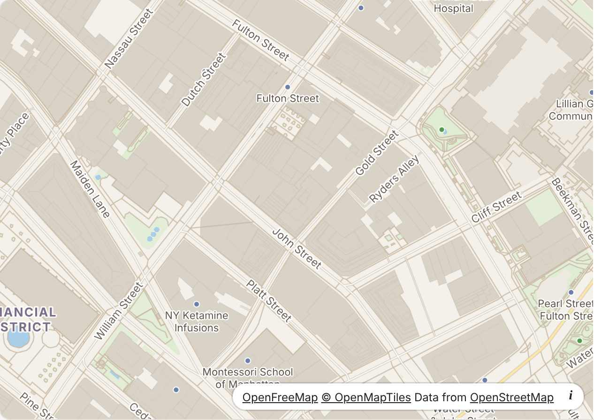
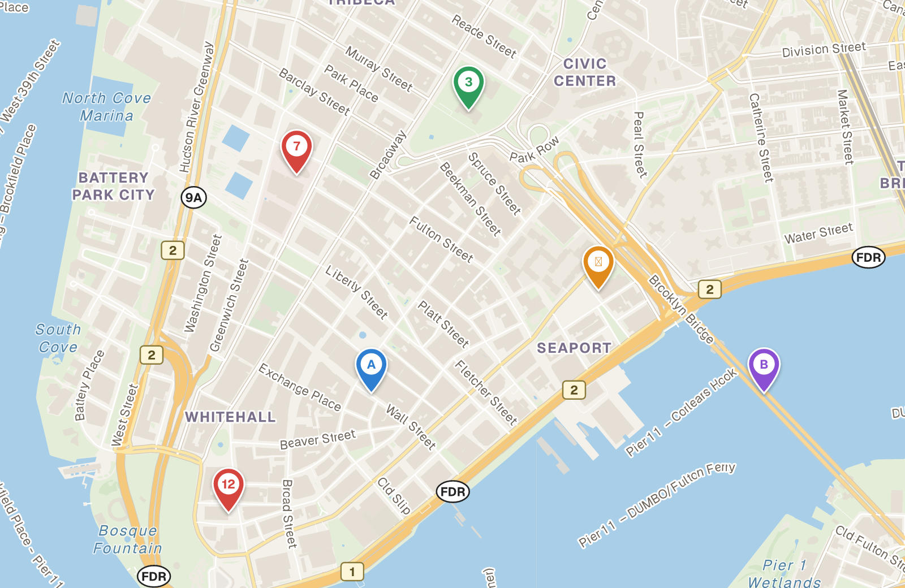
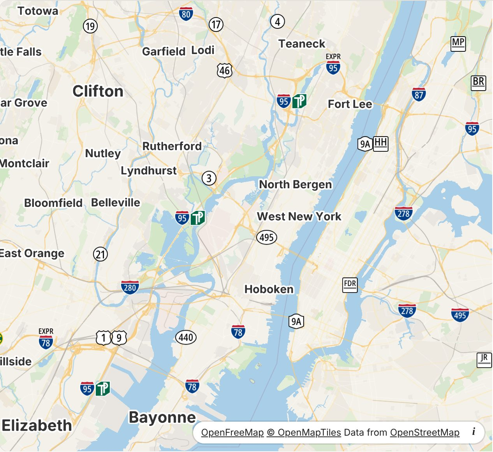

# Map Jr. GL

A small, fast map library for the web. It reads MapLibre styles. Map Jr. GL is a project of Sam Margulies and
whatismyelevation.com. It has two entries:

- `@map-jr/map-jr-gl`: a map from one description, with state that your code can watch. The adapters for frameworks
  (`@map-jr/map-jr-gl/vue`, `@map-jr/map-jr-gl/react`) and the web component `<map-jr>` (`@map-jr/map-jr-gl/element`)
  use this entry.
- `@map-jr/map-jr-gl/maplibre-compat`: an API that is almost the same as MapLibre GL JS, for code and plugins that were
  written for that library.


**[Open the live gallery](https://map-jr.github.io/map-jr-gl/)** to see each feature with the code that makes it.

Which entry to use:

| You have | Use | Why |
|---|---|---|
| A new application, or an application with Vue, Nuxt, React or Svelte | `@map-jr/map-jr-gl` and its adapters | New features go to this entry first. |
| A page in plain HTML, a CMS, or a framework with no adapter (Angular, Lit, Solid) | `@map-jr/map-jr-gl/element` | The element `<map-jr>` takes the description as attributes and properties. |
| Code or plugins that were written for MapLibre GL JS | `@map-jr/map-jr-gl/maplibre-compat` | The code keeps its calls (`new Map`, `map.on`, `map.addLayer`). |

The two entries have different methods. Each example below names its entry. The comparisons with MapLibre GL JS in
[Status](#status) (render tests, example pages, plugins) test `@map-jr/map-jr-gl/maplibre-compat`. The entry `@map-jr/map-jr-gl`
uses the same renderer and has its own tests in a browser.

## Why use this library

- **It is small.** A page with a map transfers about 118 KB of script (gzip): about 42 KB for the page script of
  `@map-jr/map-jr-gl` and about 76 KB for the worker file. MapLibre GL JS 6.17 transfers about 445 KB (page script, worker
  and CSS), which is 3.8 times as much. `pnpm test:size` fails when the library is more than a third of that. The smaller size does not include other projections than Mercator and the globe, sky, fog and the other items in
  [What is not available](docs/maplibre-compatibility.md#what-is-not-available). Custom layers are in the entry
  `@map-jr/map-jr-gl/maplibre-compat` and need `renderer: 'main'`; their code loads with the first custom layer.
- **It does not block your page.** The map draws in a worker. Your page stays responsive while the map moves.
- **It draws many markers.** A symbol layer with an SVG template as its image draws 100,000 SVG markers at 60 frames
  per second.
- **It draws on the server.** You can render the first view of a map as SVG or as an image, without a browser.
  This works on Node.js and on Cloudflare Workers.
- **It includes elevation tools.** 3D terrain, relief shading, contour lines and elevation queries use one
  elevation source. You do not need a plugin.
- **It answers questions about the data.** `querySource` reads the tile data of a source directly. You do not
  need a style layer.
- **Fonts as the style gives them.** Text uses the glyph files of the style, as MapLibre GL JS does. A style without `glyphs` uses the fonts of the browser and makes no requests for fonts.
- **It is easy to change to.** Most MapLibre GL JS code works after you change the import to
  `@map-jr/map-jr-gl/maplibre-compat`.
- **It works with MapLibre plugins.** mapbox-gl-draw, terra-draw, the compare and sync-move plugins and others run
  without changes. See [Plugins and frameworks](docs/ecosystem.md).

## Status

<!-- status:start -->
These figures are written by `pnpm status`. They compare this library with MapLibre GL JS 6.17.0.

| Measure | Result |
|---|---|
| Unit tests | 241 pass, 0 fail |
| MapLibre expression tests | 357 of 583 pass (61%), which is 84% of the 425 that are not left out on purpose. 158 are left out on purpose, 68 are planned for later, and 0 fail. |
| MapLibre `Map` methods | 131 of 138 are available; 7 more are accepted and have no effect. 15 that are internal to MapLibre GL JS are not counted. |
| Properties of the MapLibre style specification | 224 of 242 are read with every expression input that the specification allows. 16 are not read, and 2 take fewer inputs (`node test/conformance/spec.mjs --gaps` lists them). |
| MapLibre plugins, run in a browser | 16 of 16 work (see [Plugins and frameworks](docs/ecosystem.md)) |
| Plugins and frameworks, read from npm | 23 of 26 use only API that the library has |
| Example pages of the MapLibre documentation, with this library in place of MapLibre | 122 of 142 work. Most of the others need a globe, another projection or a custom 3D layer. |
| MapLibre render tests | 1209 of 1740 are the same (69.5%; 1% of pixels or less are different). 1527 of 1740 are the same or near (87.8%; 5% or less). 21 of the 213 that differ are differences that the library keeps (see [Development](docs/development.md#render-tests)). |
| Page script (gzip) | 52 KB. MapLibre GL JS: 299 KB. |
| Worker script (gzip) | 83 KB. MapLibre GL JS: 145 KB. |
| Server renderer (gzip) | 46 KB |
<!-- status:end -->

The library is new. Read [MapLibre compatibility](docs/maplibre-compatibility.md) before you use it in production.

## Install

The package is `@map-jr/map-jr-gl` on npm ([npmjs.com/package/@map-jr/map-jr-gl](https://www.npmjs.com/package/@map-jr/map-jr-gl)).
Install it with your package manager:

```bash
npm install @map-jr/map-jr-gl
```

Then import from `@map-jr/map-jr-gl`, or from `@map-jr/map-jr-gl/maplibre-compat` for the API of MapLibre GL JS.

Until then, build the package from this repository:

```bash
git clone https://github.com/map-jr/map-jr-gl.git
```

```bash
cd map-jr-gl
```

```bash
pnpm install
```

```bash
pnpm build
```

The build writes the library to the `dist` folder. Then use one of these methods:

- **With a bundler (Vite, webpack, Rollup, Parcel):** add the folder to your project as a dependency
  (`pnpm add ../map-jr-gl`). Then import from `@map-jr/map-jr-gl`.
- **Without a bundler:** copy the `dist` folder to your web server. Then import `dist/map-jr-gl.js` in a module
  script (or `dist/map-jr-gl-maplibre-compat.js` for the API of MapLibre GL JS).

The package contains ES modules only (`"type": "module"`). It has no CommonJS build, so `require('@map-jr/map-jr-gl')` does
not work: use `import`. The tests of the server renderer (`@map-jr/map-jr-gl/server`) run with Node.js 22, and `engines` in
`package.json` asks for Node.js 22 or later. The module for Nuxt (`@map-jr/map-jr-gl/nuxt`) imports `@nuxt/kit`, which a Nuxt
application has already. `package.json` names it as an optional peer dependency (version 3 or 4).

A browser must have WebGL2. [Browser support](docs/browser-support.md) says what each renderer needs and in which
browsers the library was run.

Each built file has a source map beside it (`dist/<file>.js.map`), so that an error tracker can show the lines of the
source for a stack trace.

## Use

### Show a map

This example uses the entry `@map-jr/map-jr-gl`.

```html
<div id="map" style="height: 400px"></div>
<script type="module">
  import {createMap} from '@map-jr/map-jr-gl';

  const map = createMap(document.getElementById('map'), {
    style: 'https://styles.map-jr.org/1/elevation-zero.json',
    initialView: {center: [-74.0065, 40.7085], zoom: 13.6},
  });

  // The state of the map is a store. This function runs when the view changes.
  map.state.subscribe(state => state.view, view => console.log(view.zoom));
</script>
```

To change the map, call `map.update` with the complete description again. The library finds what is different.
You do not need a CSS file. See [The main API](docs/api.md).



### Use Vue or Nuxt

```vue
<script setup>
import {ref} from 'vue';
import {MapJr} from '@map-jr/map-jr-gl/vue';

const view = ref({center: [-74.0065, 40.7085], zoom: 13.6});
</script>

<template>
  <div style="height: 400px">
    <MapJr map-style="https://styles.map-jr.org/1/elevation-zero.json" v-model:view="view" ssr />
  </div>
</template>
```

With the `ssr` prop, a server (Nuxt) renders the first view as SVG into the page. The map takes over in the
browser. See [Vue and Nuxt](docs/vue.md).

### Change from MapLibre GL JS

The entry `@map-jr/map-jr-gl/maplibre-compat` has the API of MapLibre GL JS: `new Map({...})`, `map.on(...)`,
`map.addLayer(...)`, controls, `Marker` and `Popup`.

1. Change the name of the module in each import:

   ```js
   // import {Map, Marker, Popup} from 'maplibre-gl';
   import {Map, Marker, Popup} from '@map-jr/map-jr-gl/maplibre-compat';
   ```

   If your code uses one object for the library (`maplibregl.Map`), import all the names into that object:

   ```js
   import * as maplibregl from '@map-jr/map-jr-gl/maplibre-compat';
   ```

2. Remove the other imports from `maplibre-gl/...`: the CSS file (`maplibre-gl/dist/maplibre-gl.css`) and the
   worker file (`maplibre-gl/dist/maplibre-gl-worker...`). Remove each call of `setWorkerUrl(...)` and the
   `workerUrl` prop of react-map-gl. The library finds its own worker file, and it ignores a MapLibre worker file
   with a warning.
3. Add `await` where your code calls `queryRenderedFeatures` or `querySourceFeatures`. The tile data is in a worker,
   so the complete result is a promise.
4. Start your application and read the browser console. The library writes a warning for each style layer or
   property that it cannot draw.
5. Read [MapLibre compatibility](docs/maplibre-compatibility.md) for the differences.

A plugin or a wrapper (react-map-gl, for example) that was written for MapLibre GL JS imports `maplibre-gl` itself.
Map that name to this library in your bundler or in an import map. The alias must match the name `maplibre-gl`
exactly: an alias that also matches `maplibre-gl/dist/...` makes the bundler look for those files in this package,
and the build stops. In Vite:

```js
// vite.config.js
import {defineConfig} from 'vite';

export default defineConfig({
  resolve: {
    alias: [{find: /^maplibre-gl$/, replacement: '@map-jr/map-jr-gl/maplibre-compat'}],
  },
});
```

With Vite 5 in development, also add `optimizeDeps: {exclude: ['@map-jr/map-jr-gl', 'maplibre-gl']}`, or the map
draws on the main thread; Vite 8 does not need it (see [Vite in development](docs/loading.md#vite-in-development)).
For Next.js (webpack and Turbopack), see [Next.js](docs/loading.md#nextjs). In an import map:

```html
<script type="importmap">{"imports": {"maplibre-gl": "/node_modules/@map-jr/map-jr-gl/dist/map-jr-gl-maplibre-compat.js"}}</script>
```

The library has a default export for such plugins only, because some of them contain
`import maplibregl from 'maplibre-gl'`. [Ecosystem](docs/ecosystem.md) lists the plugins that are tested.

- **react-map-gl.** Version 8 (`react-map-gl/maplibre` or `@vis.gl/react-maplibre`) works through the alias.
  Version 7 does not: it reads the private `map.transform` of MapLibre GL JS and throws a `TypeError`, through the
  alias and through its `mapLib` prop. Upgrade to version 8 first.
- **Types.** The alias does not change the types that TypeScript reads. A project that uses react-map-gl keeps
  `maplibre-gl` installed and keeps its `import type … from 'maplibre-gl'`, because react-map-gl's types refer to
  that package. The types of `@map-jr/map-jr-gl/maplibre-compat` accept values that are typed with `maplibre-gl`
  (a `StyleSpecification`, a layer or a source, for example). The reverse direction does not work: a value typed
  with the compat entry is not always assignable to a type of `maplibre-gl` or of react-map-gl.

### Add markers

A symbol layer draws many markers on the map canvas. It draws an image at each point of a GeoJSON source, and the
image can be an SVG template that each point fills with its properties.

With `@map-jr/map-jr-gl`, an image is an entry of `images` in the description, a key of `data` makes a GeoJSON
source, `points()` makes the GeoJSON from your records, and the symbol layer is an entry of `layers`:

```js
import {createMap, points} from '@map-jr/map-jr-gl';

const records = [
  {lng: -74.006, lat: 40.7128, color: '#d6453d', name: 'City Hall'},
  {lng: -73.9857, lat: 40.7484, color: '#2f7fd1', name: 'Empire State Building'},
];

const map = createMap(document.getElementById('map'), {
  style: 'https://styles.map-jr.org/1/elevation-zero.json',
  initialView: {center: [-73.996, 40.73], zoom: 11.5},
  images: {disc: '<svg viewBox="0 0 24 24"><circle cx="12" cy="12" r="10" fill="{{color}}"/></svg>'},
  data: {places: points(records, {lngLat: r => [r.lng, r.lat]})},
  layers: [{id: 'places', type: 'symbol', source: 'places', layout: {'icon-image': 'disc', 'icon-allow-overlap': true, 'icon-ignore-placement': true}}],
  // A marker is a feature of its layer: a click has it in `features`.
  interactiveLayers: ['places'],
  onClick: event => console.log(event.features[0]?.properties.name),
});
```

With `@map-jr/map-jr-gl/maplibre-compat`, write the source and the layer yourself, as with MapLibre GL JS (`map.addImage`, `map.addSource`,
`map.addLayer`). [Markers](docs/markers.md) has the code.

For a small number of markers with HTML content, use `map.overlay` (`@map-jr/map-jr-gl`) or `Marker` and `Popup`
(`@map-jr/map-jr-gl/maplibre-compat`, the same API as MapLibre GL JS). See [Markers](docs/markers.md).



### Show terrain, relief and contour lines

With `@map-jr/map-jr-gl`, the elevation source, the layers and the terrain are additions to the style (the fields `sources`, `layers` and `terrain`):

```js
import {createMap} from '@map-jr/map-jr-gl';

const map = createMap(document.getElementById('map'), {
  style: 'https://styles.map-jr.org/1/elevation-zero.json',
  initialView: {center: [7.6586, 45.9763], zoom: 12.4, pitch: 60},
  sources: {
    dem: {type: 'raster-dem', tiles: ['https://tiles.mapterhorn.com/{z}/{x}/{y}.webp'], encoding: 'terrarium', tileSize: 512, maxzoom: 12},
    contours: {type: 'contour', source: 'dem', thresholds: {11: [100, 500], 12: [50, 200], 14: [20, 100]}},
  },
  layers: [
    {id: 'relief', type: 'hillshade', source: 'dem'},
    {id: 'contour-lines', type: 'line', source: 'contours', 'source-layer': 'contours'},
  ],
  terrain: {source: 'dem', exaggeration: 1.5},
});

const metres = await map.queryElevation([7.6586, 45.9763]);
```

With `@map-jr/map-jr-gl/maplibre-compat`, where `map` is a `Map` whose style has loaded:

```js
map.addSource('dem', {
  type: 'raster-dem',
  tiles: ['https://tiles.mapterhorn.com/{z}/{x}/{y}.webp'],
  encoding: 'terrarium',
  tileSize: 512,
  maxzoom: 12,
});

map.addLayer({id: 'relief', type: 'hillshade', source: 'dem'});
map.setTerrain({source: 'dem', exaggeration: 1.5});

map.addSource('contours', {
  type: 'contour',
  source: 'dem',
  thresholds: {11: [100, 500], 12: [50, 200], 14: [20, 100]},
});
map.addLayer({id: 'contour-lines', type: 'line', source: 'contours', 'source-layer': 'contours'});

const metres = await map.queryElevation([7.6586, 45.9763]);
```

See [Terrain and elevation](docs/terrain-and-elevation.md).

### Find what is at a position

With `@map-jr/map-jr-gl`, `querySource` reads the tile data of one source. It finds data that the style does not
draw, and it also works for a position that is not on the screen. `queryFeatures` gives the features that the style
layers draw, and it never reads other data. `radius` is the distance around the place in pixels, in both methods. See [Queries](docs/api.md#queries).

```js
import {createMap} from '@map-jr/map-jr-gl';

const map = createMap(document.getElementById('map'), {
  style: 'https://styles.map-jr.org/1/elevation-zero.json',
  initialView: {center: [-74.0065, 40.7085], zoom: 16},
  onClick: async event => {
    // "openmaptiles" is the id of the vector source in this style.
    const features = await map.querySource('openmaptiles', event.lngLat, {radius: 8});
    console.log(features.map(feature => feature.properties));
  },
});
```

With `@map-jr/map-jr-gl/maplibre-compat`, `map.queryFeatures` and `map.querySource` are the same methods. `queryRenderedFeatures` and
`querySourceFeatures` are also available:

```js
import {Map} from '@map-jr/map-jr-gl/maplibre-compat';

const map = new Map({container: 'map', style: 'https://styles.map-jr.org/1/elevation-zero.json', center: [-74.0065, 40.7085], zoom: 16});
map.on('click', async event => {
  const features = await map.querySource('openmaptiles', event.lngLat, {radius: 8});
  console.log(features.map(feature => feature.properties));
});
```



### Render the first view on the server

This example uses the entry `@map-jr/map-jr-gl/server`.

```js
import {renderToSVG} from '@map-jr/map-jr-gl/server';

const {svg} = await renderToSVG({
  style: 'https://styles.map-jr.org/1/elevation-zero.json',
  center: [-74.0065, 40.7085],
  zoom: 14.3,
  width: 800,
  height: 500,
});
```

Put the SVG in the map container of your HTML page. The live map replaces it when the map is ready.
The same function runs in a browser, so a page can export a map as a vector SVG with no server.
See [Server rendering](docs/server-rendering.md).



### Use highway shields and other icons that are generated on demand

This example uses the entry `@map-jr/map-jr-gl/maplibre-compat`, where `map` is a `Map`. The description of `@map-jr/map-jr-gl` has
no field for this yet.

```js
map.setMissingStyleImageResolver(name => {
  if (name.startsWith('shield|')) return map.addImage(name, drawShieldAsSVG(name));
});
```

The OSM Americana shield library works with this library without changes.

A label can contain images (`format` with `image`). So a road with two routes shows two shields side by side.



## How the library loads

The default configuration needs no settings.

- The page loads `map-jr-gl.js`. This file is small.
- The library starts a worker from `map-jr-gl-worker.js`. It finds this file next to `map-jr-gl.js`. Bundlers copy
  the file automatically.
- If a worker cannot start, or loses its WebGL context again directly after the map has started it again, the library draws on the main thread and writes a warning. A map always appears.

See [Loading](docs/loading.md) for a CDN, a strict Content Security Policy, the one-file
build and other configurations.

## Speed

<!-- speed:start -->
Measured by the workflow [Browsers](https://github.com/map-jr/map-jr-gl/tree/bench-results) on 2026-11-19 (commit dea6a7f). Each cell is MapLibre GL JS 6.17.0 / **this library** (worker renderer where the browser has it).

| System, browser | Load to idle, ms | Frames per second, map moving | Frames per second, 10,000 markers |
|---|---|---|---|
| macOS, Chromium | 904 / **431** | 22 / **26** | 5 / **23** |
| macOS, WebKit | 915 / **315** | 60 / **52** | 8 / **50** |
| Linux, Firefox | 1133 / **490** | 18 / **56** | 6 / **44** |
| Linux, WebKit | 1277 / **511** | 17 / **15** | 3 / **21** |
| Windows, Chromium | 1145 / **687** | 19 / **15** | 1 / **41** |
| Windows, Firefox | 1219 / **754** | 22 / **15** | 6 / **29** |
| Windows, WebKit | 1674 / **935** | 13 / **11** | 3 / **16** |
<!-- speed:end -->

These computers are virtual machines, and those for Linux and Windows have no GPU: use the table to compare the
two libraries, not as the speed of a real device. On an Apple M4 the two libraries draw 60 frames each second;
this library loads faster (490 ms against 781 ms) and uses no page script for a frame.

To measure on your device, open [the benchmark page](https://map-jr.github.io/map-jr-gl/bench/) of the gallery site, or run `pnpm demo` and open `http://localhost:8080/bench`. `pnpm status` writes the table.

## Documents

- [The main API](docs/api.md): `createMap`, the description of a map, the state, queries.
- [Vue and Nuxt](docs/vue.md): the component, the composable, server rendering.
- [React](docs/react.md): the component, the hooks, server rendering.
- [Svelte](docs/svelte.md): an action and a store.
- [The web component](docs/element.md): the element `<map-jr>`, for plain HTML and frameworks without an adapter.
- [Loading](docs/loading.md): how the files load, and how to change that.
- [Markers](docs/markers.md): symbol layers with images that are SVG templates, and DOM markers.
- [Terrain and elevation](docs/terrain-and-elevation.md): terrain, relief shading, contour lines, elevation queries.
- [Server rendering](docs/server-rendering.md): SVG and images on Node.js, on Cloudflare Workers and in a browser.
- [Accessibility](docs/accessibility.md): what the library does for keyboard users and assistive technology, and what it
  does not do yet.
- [MapLibre compatibility](docs/maplibre-compatibility.md): what is the same, what is different, what is not
  available.
- [Plugins and frameworks](docs/ecosystem.md): which popular MapLibre plugins find the API that they use.
- [Browser support](docs/browser-support.md): what a browser must have, what each renderer needs, and where the
  library was run.
- [Development](docs/development.md): how to build, test, measure and release the library.
- [Changelog](CHANGELOG.md): what each version contains, and what is known not to work.
- [Security](SECURITY.md): how to report a vulnerability privately, and what is in scope.
- [Similarity scan](docs/similarity-scan.md): how the source was compared with MapLibre GL JS and other projects, and
  the result.
- [Contributing](CONTRIBUTING.md) and the [open issues](https://github.com/map-jr/map-jr-gl/issues): what is known to be wrong or missing, by priority.

## How this project is made

Map Jr. GL is a project of Sam Margulies and whatismyelevation.com. An AI coding assistant wrote almost all the code
of this project ("vibe coding"). A person gave the directions and reviewed the results. Nobody reviewed every line of the code. Read [Acknowledgements](ACKNOWLEDGEMENTS.md) for
more information, and run your own tests before you use the library for important work.

## Licence and acknowledgements

The licence is MIT. See [LICENSE](LICENSE).

The library follows [MapLibre GL JS](https://github.com/maplibre/maplibre-gl-js) (BSD-3-Clause) but contains none of
its files. A [similarity scan](docs/similarity-scan.md) of the source against MapLibre GL JS 6.17.0 and the other
projects found no copied block. [Acknowledgements](ACKNOWLEDGEMENTS.md) lists the projects that this library uses or follows.
[THIRD-PARTY-LICENSES.md](THIRD-PARTY-LICENSES.md) contains their licence texts.
